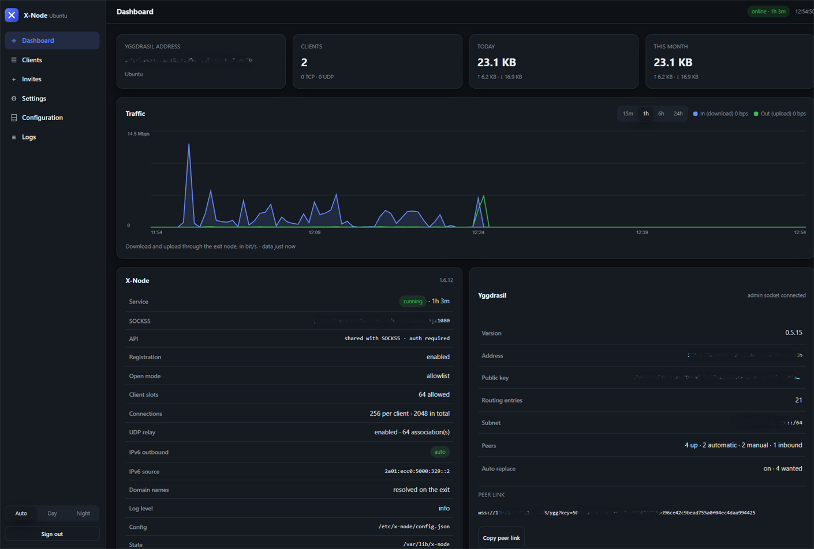
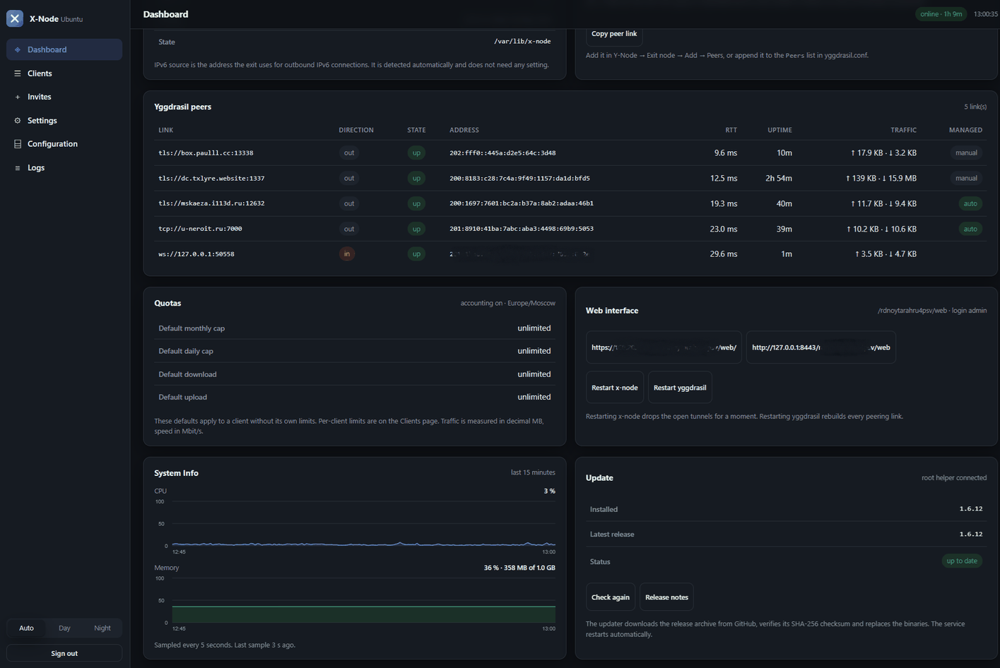

# X-Node

**English** · [Русский](README.ru.md)

**X-Node** is a server-side exit node for the [Yggdrasil](https://yggdrasil-network.github.io/) network. It gives connected nodes access to the regular Internet over SOCKS5, manages client access, meters traffic and lets you set individual quotas.

X-Node is designed to work with the [Y-Node](https://github.com/MrKsey/y-node) Android client, but is not tied to it: any SOCKS5 client with access to the Yggdrasil network can connect.

<p align="center">
  
</p>

<p align="center">
  
</p>

## Purpose and how it works

Yggdrasil is a decentralized IPv6 overlay network. It provides connectivity between its own nodes, but does not by itself route traffic to the regular Internet.

An **exit node** acts as a gateway between Yggdrasil and external networks: it accepts client requests and sends them to the Internet on behalf of the server. X-Node provides a SOCKS5 interface for this and applies access rules and traffic limits.

To connect, a client needs a working Yggdrasil node and must be registered in the list of addresses allowed by X-Node. Identification is performed by the node's IPv6 address in the Yggdrasil network.

How traffic flows for both types of clients:

```text
     Y-Node client (Android)                        X-Node (Ubuntu)                    Internet
┌───────────────────────────────┐             ┌──────────────────────────┐          ┌────────────┐
│ apps on the phone             │ ──────────► │ SOCKS5 [200:...]:1080    │ ───────► │ sites and  │
│ VPN → Yggdrasil node          │ ◄────────── │ allowlist, quotas        │ ◄─────── │ services   │
└───────────────────────────────┘             └──────────────────────────┘          └────────────┘
   Yggdrasil, IPv6, encryption                     outbound IPv4/IPv6

    Plain SOCKS5 client (PC)                        X-Node (Ubuntu)                    Internet
┌───────────────────────────────┐             ┌──────────────────────────┐          ┌────────────┐
│ browser, application          │ ──────────► │ SOCKS5 [200:...]:1080    │ ───────► │ sites and  │
│ SOCKS5 proxy → Yggdrasil      │ ◄────────── │ allowlist, quotas        │ ◄─────── │ services   │
└───────────────────────────────┘             └──────────────────────────┘          └────────────┘
   Yggdrasil, IPv6, encryption                     outbound IPv4/IPv6
```

In both cases traffic travels over the Yggdrasil IPv6 tunnel to X-Node and only then to the regular Internet. The only difference is who runs the Yggdrasil node and the SOCKS5 client: in Y-Node it is a single app, otherwise they are separate programs on the device.

## Key features

- **SOCKS5 proxy.** Handling of TCP and UDP traffic, including DNS queries and QUIC.
- **IPv4 and IPv6 egress.** Domain name resolution on the server side and selection of an available protocol for the outgoing connection. The IPv6 route is checked with a real connection, so a host that has an address the provider does not route is reported as such instead of being treated as working.
- **Access management.** Client registration via one-time invites with a QR code, or manual addition of addresses. Each client can be given a label and its access managed. The QR code and link of an already allowed client can be shown again from the CLI and the web interface.
- **Quotas and speed limits.** Individual daily and monthly traffic limits, as well as inbound and outbound speed limits.
- **Traffic accounting.** Separate statistics for each client: per day, per month and for all time. Counters survive service restarts.
- **Web interface.** Monitoring of the node, clients, peers and traffic; management of invites, quotas and settings; log viewing and configuration editing.
- **DNS server for clients.** An optional [Alfis](https://github.com/Revertron/Alfis) resolver on the Yggdrasil address of the exit: `.ygg` names from the Alfis zone and ordinary names through upstream resolvers. It is installed by default, managed by `x-node-dns.service`, and advertised to Y-Node automatically.
- **Yggdrasil peer management.** Automatic selection of public peers, availability checks and replacement of unstable nodes. Peers added manually are kept without automatic replacement.
- **CLI.** Management of the server, clients, invites, quotas and peers from the command line.
- **Updates and diagnostics.** New version checks, binary updates and a built-in check of the configuration and installation state.

## Installation

Ubuntu 24.04 and Debian 12 are supported. Installation is performed as `root`:

```bash
```bash
curl -fsSL https://raw.githubusercontent.com/MrKsey/x-node/main/install.sh | sudo bash
```

The script is piped into `bash` on purpose: `sudo bash <(curl ...)` does not work, because `sudo` closes the extra file descriptor that the process substitution uses, and bash then fails with `/dev/fd/63: No such file or directory`. Add installer options after `-s --`, for example `... | sudo bash -s -- --yes`.
```

The installer downloads the current release, installs Yggdrasil and the X-Node components, configures network parameters and systemd services. During the process you can specify the node name, public address, peering parameters, web interface settings and whether the DNS server should run.

After installation you are offered to create the first invite for connecting a client. The web interface address and administrator credentials are printed at the end of the installation and saved to:

```text
/root/x-node-credentials.txt
```

An alternative is to download the archive of the required release from [GitHub Releases](https://github.com/MrKsey/x-node/releases), unpack it and run `install.sh`:

```bash
sudo ./install.sh
```

### Non-interactive installation

```bash
sudo ./install.sh --yes --name "Exit Node" --public-host exit.example.com
```

Main installer options:

| Option | Purpose |
| --- | --- |
| `--name TEXT` | Node name shown in the app and the web interface |
| `--public-host HOST` | Public IP address or domain name for inbound peering |
| `--ygg-proto wss\|tls` | Inbound peering protocol: WebSocket via nginx or direct TLS |
| `--ygg-port N` | Inbound peering port; `0` disables inbound connections |
| `--socks-port N` | SOCKS5 port on the Yggdrasil interface (default `1080`) |
| `--api-port N` | Registration and status API port; `0` shares the SOCKS5 port |
| `--peers LIST\|auto\|keep` | Peer list, automatic selection or keeping the current configuration |
| `--peer-count N` | Number of public peers maintained automatically |
| `--allow-all` | Allow all Yggdrasil nodes to connect without invite checks and the access list |
| `--no-registration` | Disable client registration by invite |
| `--no-invite` | Do not create the first invite automatically |
| `--ipv6 auto\|prefer\|off` | Outbound IPv6 policy |
| `--web` / `--no-web` | Enable or disable the web interface |
| `--web-port N` | Web interface port |
| `--web-password PASS` | Set the administrator password |
| `--dns` / `--no-dns` | Enable or skip the Alfis DNS server (default: ask, default yes) |
| `--dns-port N` | DNS port on the Yggdrasil address (default `53`) |
| `--dns-web-port N` | Alfis web interface port (default `8082`) |
| `--alfis-version VER` | Download this Alfis version instead of the bundled binary (default: the bundled `0.10.0`) |
| `--firewall` | Install nftables rules |
| `--upgrade` | Upgrade X-Node keeping settings and state |
| `--yes` | Disable interactive questions |

The full list of options is available via `./install.sh --help`.

The `--public-host` option sets the address that other nodes will use to establish an inbound peering connection to the server. If the server is behind NAT, uses a domain name or a non-standard port, the public address should be specified explicitly.

If inbound peers are not needed, use `--ygg-port 0`. In this mode the server only establishes outbound connections to public peers, and clients reach X-Node through the Yggdrasil network itself.

> **Warning:** the `--allow-all` mode disables invite checks and the client allowlist. Any Yggdrasil node will be able to use the server as an exit node. Do not enable this mode on a public server without understanding the consequences.

## Network ports and access

By default the inbound peering port is TCP/443. In `wss` mode peering runs over WebSocket and nginx; the web interface can use the same external HTTPS port. In `tls` mode a direct TLS connection is used, and the web interface is usually available on a separate port.

The SOCKS5 and API ports are bound to the server's Yggdrasil address and are not intended for direct access from the regular Internet. External access to the web interface depends on the chosen publication scheme.

The current panel address can be obtained with:

```bash
sudo x-node web url
```

## DNS server

X-Node can run [Alfis](https://github.com/Revertron/Alfis) as a DNS resolver for its clients. It listens on the Yggdrasil address of the exit and is reachable only through Yggdrasil:

- `.ygg` names and other Yggdrasil names come from the Alfis zone;
- ordinary names are forwarded to the upstream resolvers from `dns.forwarders` (two Quad9 addresses by default);
- the Alfis web interface listens on loopback port `8082`, is protected by its own password and is opened through the dashboard proxy.

The installer enables the server by default. It installs the `alfis` binary, writes `/etc/x-node/alfis.conf`, creates `/var/lib/x-node-dns` and enables `x-node-dns.service`. The unit runs as the `x-node` user with `CAP_NET_BIND_SERVICE` and a read-only filesystem except for its state directory.

Release archives bundle Alfis built with the `webui` feature, so the panel link works out of the box. The upstream `nogui` binaries are built without it: when such a binary is installed instead (a local build or an older archive), the resolver keeps working, the unit omits `--web-ui` and the link is hidden.

The same switch is available in three places:

```bash
sudo x-node dns status
sudo x-node dns on
sudo x-node dns off
```

- **Settings → DNS server** in the web interface: the switch, the Alfis web password and a link that opens the Alfis panel in a new tab;
- the **DNS server** card on the dashboard: state, listen address, password and the same link;
- `x-node status`: a short DNS section.

The panel is proxied by the daemon under the sibling of the dashboard path: when the interface lives at `/<random>/web`, the panel is at `/<random>/dns/`. It opens on the same TLS endpoint and port as the dashboard, so no second public port is needed; the installer adds the nginx location for it. The proxy does not bypass the Alfis password.

When the server is enabled, the status API reports `capabilities.dns = true` with `dnsAddress` and `dnsPort`. Y-Node reads them and offers the resolver under **Available servers** as **DNS from exit node**; the **DNS exit node** switch in the Y-Node exit settings puts it into **IN USE** with a lock. The `yggnode://` link does not carry the resolver: the app learns it from the status API, like quotas, so the link stays valid when DNS is turned on later.

The configuration lives in the `dns` section of `config.json`:

```json
{
  "dns": {
    "enabled": true,
    "port": 53,
    "webPort": 8082,
    "forwarders": ["94.140.14.14:53", "94.140.15.15:53"],
    "cacheMemoryLimitMB": 100
  }
}
```

`dns.listen` is derived from `listenAddress` and the DNS port; `dns.webListen` defaults to loopback and the panel is reached through the dashboard. Set them explicitly only when the resolver must bind another address. `dns.webPassword` is generated when the server is first enabled and is shown on the dashboard and in `/root/x-node-credentials.txt`.

If the archive has no bundled binary and Alfis cannot be downloaded during the installation, the exit still installs and runs; the DNS card shows that Alfis is missing, and `x-node dns on` explains what to do after the binary is installed.

## Management

X-Node provides a web interface and a CLI. The web panel includes the following sections:

- **Dashboard** — server state, traffic statistics, peers, quotas, the DNS server and the main node parameters.
- **Clients** — the list of registered clients, device details, statistics, access and limit management.
- **Invites** — creating and revoking invites, setting the expiry time and the number of registrations, viewing QR codes.
- **Settings** — node, DNS server, access, limits, UDP, IPv6, public and manual peers, and web interface parameters.
- **Configuration** — viewing and editing `config.json`, `yggdrasil.conf` and `alfis.conf` with validation before saving, and restart buttons for x-node, yggdrasil and the DNS server.
- **Logs** — viewing the latest log entries, with a wrap-lines switch and a link to the built-in guide.

Administrative operations such as applying configuration and restarting services from the web interface are handled by a separate `x-node-helper` service. It performs privileged actions over a Unix socket without giving the web process full root access.

Main CLI commands:

```bash
sudo x-node status                 # server and component state
sudo x-node clients                # client list and statistics
sudo x-node allow list             # allowed addresses
sudo x-node allow add <address>    # allow a client without an invite
sudo x-node allow link <address>   # QR code and link for an allowed client
sudo x-node allow remove <address> # revoke access
sudo x-node invite                 # create an invite and QR code
sudo x-node invite list            # list active invites
sudo x-node invite remove <id>     # revoke an invite
sudo x-node keygen                 # create keys and get the Yggdrasil address
sudo x-node doctor                 # installation diagnostics
sudo x-node peers                  # peer state
sudo x-node usage                  # traffic statistics
sudo x-node quota show             # current quotas
sudo x-node web url                # web interface address
sudo x-node web password           # change the web interface password
sudo x-node dns status             # DNS server state
sudo x-node dns on                 # start the DNS server
sudo x-node dns off                # stop the DNS server
```

## Connecting clients

### Y-Node for Android

1. Install [Y-Node](https://github.com/MrKsey/y-node) and connect to the Yggdrasil network.
2. Create an invite on the server:

   ```bash
   sudo x-node invite
   ```

3. In Y-Node open the **Exit node** section, add a profile and scan the QR code.
4. Activate the exit node in the app.

An invite is intended for one-time registration. After registration the device is added to the client allowlist.

### Allowing a client without an invite

An invite is not the only way in. A client address can be added to the allowlist directly from the command line:

```bash
sudo x-node allow add 201:1ba8:15c:b1be:7555:b3d7:7651:8e2e -label "laptop"
```

`-label` is an optional name shown in the web interface and in `x-node clients`. The command works while the service is running: the change is picked up immediately, no restart is needed.

Listing the allowlist and revoking access:

```bash
sudo x-node allow list
sudo x-node allow remove 201:1ba8:15c:b1be:7555:b3d7:7651:8e2e
```

Only Yggdrasil node addresses from the `200::/7` range are accepted — the same address the client shows on its side. No SOCKS5 login or password is involved: access is decided by the source address the connection comes from. A separate token (`sudo x-node allow token <address>`) is only needed for the HTTP API, for example for status requests from Y-Node.

### Restoring a deleted exit profile

If the exit profile was deleted in Y-Node, there is no need to create a new invite. The link for an already allowed client is printed again:

```bash
sudo x-node allow link 201:1ba8:15c:b1be:7555:b3d7:7651:8e2e
```

The command prints the same QR code and `yggnode://` link, but without an invite: the exit recognises the device by its Yggdrasil address. The same QR code and link are available in the web interface on the **Clients** tab with the **QR / link** button. In Y-Node, import the link with **Exit nodes → Import from link** or scan the QR code; the app fetches an API token from the exit on its own. Without a token the profile still works as a plain SOCKS5 proxy.

### Other SOCKS5 clients

X-Node works with any SOCKS5 client: a browser, Telegram, a mail client, `curl`, the proxy settings of the operating system. The only difference from Y-Node is that a third-party program cannot bring up Yggdrasil or register by QR code on its own, so the connection is configured by hand.

How to connect:

1. **Install Yggdrasil on the client device.** Use the official client from [yggdrasil-network.github.io](https://yggdrasil-network.github.io/); ready-made builds exist for Linux, Windows, macOS and Android. Once it runs, the device gets an IPv6 address in the Yggdrasil network and can reach other nodes.

2. **Find the client's Yggdrasil address.** On Linux:

   ```bash
   sudo yggdrasil -useconffile /etc/yggdrasil/yggdrasil.conf -address
   ```

   Or, when the service is running and the admin socket is available:

   ```bash
   sudo yggdrasilctl getSelf
   ```

   The address looks like `200:1234:5678:9abc:def0:1234:5678:9abc`. The Windows and macOS GUI clients show it on the main screen.

3. **Allow that address on the X-Node server:**

   ```bash
   sudo x-node allow add 200:1234:5678:9abc:def0:1234:5678:9abc -label "home-pc"
   sudo x-node allow list
   ```

   Without an allowlist entry X-Node refuses the connection even when the proxy is configured correctly.

4. **Find the server's Yggdrasil address and SOCKS5 port:**

   ```bash
   sudo x-node status
   ```

   The `Node` section has the two lines you need:

   ```text
   Yggdrasil address:  200:1234:5678:9abc:def0:1234:5678:9abc
   SOCKS5 port:        1080
   ```

   In proxy settings the address is written in square brackets together with the port:

   ```text
   [200:1234:5678:9abc:def0:1234:5678:9abc]:1080
   ```

   The installer prints the same values at the end of the installation.

5. **Set the proxy in the client.** Type SOCKS5, host — the server's Yggdrasil address, port — from `x-node status`, leave the username and password empty. Turn on remote DNS resolution (called "SOCKS5h", "remote DNS" or "proxy DNS" depending on the program), otherwise domain names are resolved on the client and some sites will not open.

6. **Check the connection.** From the command line:

   ```bash
   curl --socks5-hostname "[200:1234:5678:9abc:def0:1234:5678:9abc]:1080" https://ifconfig.me
   ```

   The command must return the public IPv4 or IPv6 address of the X-Node server, not your provider's address. In a browser, set the SOCKS5 proxy to `[200:1234:5678:9abc:def0:1234:5678:9abc]:1080` with no credentials and open `https://ifconfig.me` — the address must match the server's public address.

   For programs that read environment variables:

   ```bash
   export ALL_PROXY="socks5h://[200:1234:5678:9abc:def0:1234:5678:9abc]:1080"
   ```

If the connection does not come up, check in order: whether Yggdrasil runs on the client and the server address answers (`ping6 200:1234:5678:9abc:def0:1234:5678:9abc`, on Windows `ping -6`), whether the client address is in `sudo x-node allow list`, and whether the address and port in the proxy settings match. `sudo x-node doctor` shows the overall server health.

## Quotas and statistics

For each client you can set a daily and a monthly traffic limit, as well as download and upload speed limits.

Example commands:

```bash
sudo x-node usage
sudo x-node quota set <address> -monthly 100GB -down 20Mbps
sudo x-node quota set <address> -daily 5GB -up 5Mbps
sudo x-node quota show
sudo x-node quota reset <address>
```

Volume values support decimal units (`MB`, `GB`) and binary ones (`MiB`, `GiB`, `TiB`). Speed is set in `Kbps`, `Mbps` or `Gbps`. A zero value means no limit.

The volume limit is checked when a new TCP connection or UDP association is created. Already established connections are not dropped when the quota is reached. The speed limit applies to the client's traffic as a whole, not to each connection separately.

## Updating and removal

Updating from a directory with the archive of a new version:

```bash
sudo ./install.sh --upgrade --yes
```

The update replaces the X-Node binaries and keeps the configuration, clients, invites, quotas, traffic counters and the peer list. The root helper repairs `x-node.service` when it starts: the old `Requires=yggdrasil.service` becomes `Wants=yggdrasil.service`, `PartOf=yggdrasil.service` is dropped, and every other line stays as it is, so stopping yggdrasil no longer stops x-node. Run `sudo systemctl restart x-node-helper` to apply the repair right away.

You can also check for a new version and upgrade via the CLI:

```bash
x-node update check
sudo x-node update upgrade
```

Removal runs as a single command, just like the installation:

```bash
curl -fsSL https://raw.githubusercontent.com/MrKsey/x-node/main/uninstall.sh | sudo bash
```

The script stops and removes the X-Node services, configuration and binaries. By default it keeps `/var/lib/x-node` (clients, invites, quotas, traffic counters and the peer list) and the installed Yggdrasil, so a reinstall does not require registering the devices again.

The options are the same as in the local `uninstall.sh`:

| Option | Purpose |
| --- | --- |
| `--yes` | no interactive questions |
| `--purge` | also remove `/var/lib/x-node` and the Yggdrasil package |
| `--keep-state` | keep `/var/lib/x-node` (the default) |
| `--keep-yggdrasil` | never touch Yggdrasil, even with `--purge` |

For example, a full removal including the data and Yggdrasil:

```bash
curl -fsSL https://raw.githubusercontent.com/MrKsey/x-node/main/uninstall.sh | sudo bash -s -- --purge --yes
```

To remove X-Node but keep Yggdrasil:

```bash
curl -fsSL https://raw.githubusercontent.com/MrKsey/x-node/main/uninstall.sh | sudo bash -s -- --purge --keep-yggdrasil --yes
```

When the release archive is already unpacked, the local script does the same with the same options:

```bash
sudo ./uninstall.sh --yes
```

## Diagnostics

For a first check use:

```bash
sudo x-node doctor
sudo x-node status
sudo x-node clients
sudo journalctl -u x-node -f
```

If a client cannot connect, check the availability of the Yggdrasil network, whether its address is in the client allowlist and whether the SOCKS5 port is correct. The reasons for quota and limit refusals are shown in the client statistics.

## Building from source

Go tools are used to build and check the project:

```bash
go build ./...
go test ./...
go vet ./...

./build.sh          # Linux/amd64
GOARCH=arm64 ./build.sh
```

## Donations

You can support the project with a donation to any of the wallets below.

<table>
  <tr>
    <td align="center">
      <br>
      <b>Bitcoin</b><br>
      <code>bc1qdf9wryj6tnyyr7ed4dkfv03nn0dxjf27xshfcr</code>
    </td>
    <td align="center">
      <br>
      <b>Ethereum</b><br>
      <code>0xE22FAB5337A5506D9e7Ef9D4914De4d963Fbbf88</code>
    </td>
  </tr>
  <tr>
    <td align="center">
      <br>
      <b>Solana</b><br>
      <code>7XcNM2M9rndFbJdjRtyycxkQXq8dPXEP87toiQX4EZfx</code>
    </td>
    <td align="center">
      <br>
      <b>Tron</b><br>
      <code>TCYpTxSmdPN8p4fmRwtPGk3HHBf77FypeA</code>
    </td>
  </tr>
</table>

## License

The project is distributed under the [MIT](LICENSE) license.
