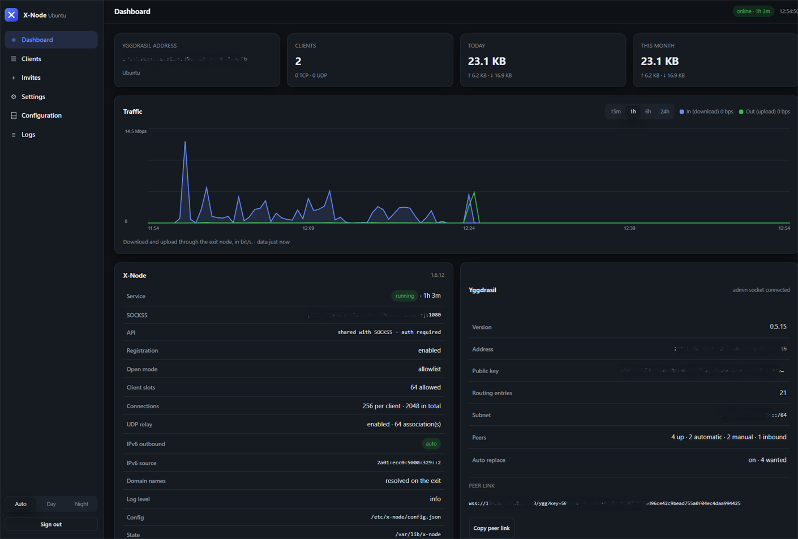
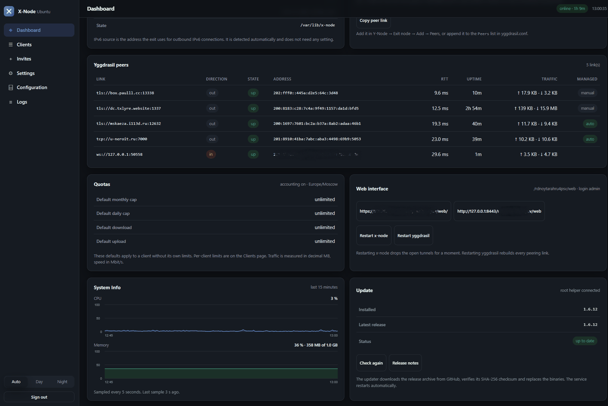

# X-Node

[English](README.md) · **Русский**

**X-Node** — серверный Exit Node для сети [Yggdrasil](https://yggdrasil-network.github.io/). Он предоставляет подключённым узлам доступ к обычному Интернету через SOCKS5, управляет доступом клиентов, учитывает трафик и позволяет задавать индивидуальные квоты.

X-Node разработан для совместной работы с Android-клиентом [Y-Node](https://github.com/MrKsey/y-node), но не привязан к нему: подключиться может любой SOCKS5-клиент, имеющий доступ к сети Yggdrasil.

<p align="center">
  
</p>

<p align="center">
  
</p>

## Назначение и принцип работы

Yggdrasil — децентрализованная IPv6 overlay-сеть. Она обеспечивает связь между своими узлами, но сама по себе не маршрутизирует трафик в обычный Интернет.

**Exit Node** выполняет роль шлюза между Yggdrasil и внешними сетями: принимает запросы клиентов и отправляет их в Интернет от имени сервера. X-Node предоставляет для этого SOCKS5-интерфейс и применяет правила доступа и ограничения трафика.

Для подключения клиент должен иметь работающий узел Yggdrasil и быть зарегистрирован в списке разрешённых адресов X-Node. Идентификация выполняется по IPv6-адресу узла в сети Yggdrasil.

## Основные возможности

- **SOCKS5-прокси.** Обработка TCP- и UDP-трафика, включая DNS-запросы и QUIC.
- **Выход в IPv4 и IPv6.** Разрешение доменных имён на стороне сервера и выбор доступного протокола для исходящего соединения.
- **Управление доступом.** Регистрация клиентов по одноразовым приглашениям с QR-кодом или добавление адресов вручную. Для каждого клиента можно задать метку и управлять его доступом.
- **Квоты и ограничения скорости.** Индивидуальные дневные и месячные лимиты трафика, а также ограничения входящей и исходящей скорости.
- **Учёт трафика.** Раздельная статистика по каждому клиенту: за день, месяц и за всё время. Счётчики сохраняются после перезапуска сервиса.
- **Веб-интерфейс.** Мониторинг состояния узла, клиентов, пиров и трафика; управление приглашениями, квотами и настройками; просмотр журналов и редактирование конфигурации.
- **Управление пирами Yggdrasil.** Автоматический подбор публичных пиров, проверка их доступности и замена нестабильных узлов. Пиры, добавленные вручную, сохраняются без автоматической замены.
- **CLI.** Управление сервером, клиентами, приглашениями, квотами и пирами из командной строки.
- **Обновление и диагностика.** Проверка новых версий, обновление исполняемых файлов и встроенная проверка конфигурации и состояния установки.

## Установка

Поддерживаются Ubuntu 24.04 и Debian 12. Установка выполняется от имени `root`:

```bash
sudo bash <(curl -fsSL https://raw.githubusercontent.com/MrKsey/x-node/main/install.sh)
```

Установщик загрузит актуальный релиз, установит Yggdrasil и компоненты X-Node, настроит сетевые параметры и systemd-сервисы. В процессе можно указать имя узла, внешний адрес, параметры пиринга и настройки веб-интерфейса.

После установки будет предложено создать первое приглашение для подключения клиента. Адрес веб-интерфейса и учётные данные администратора выводятся в конце установки и сохраняются в:

```text
/root/x-node-credentials.txt
```

Альтернативный способ — скачать архив нужного релиза из [GitHub Releases](https://github.com/MrKsey/x-node/releases), распаковать его и запустить `install.sh`:

```bash
sudo ./install.sh
```

### Установка без интерактивных вопросов

```bash
sudo ./install.sh --yes --name "Exit Node" --public-host exit.example.com
```

Основные параметры установщика:

| Параметр | Назначение |
| --- | --- |
| `--name TEXT` | Имя узла, отображаемое в приложении и веб-интерфейсе |
| `--public-host HOST` | Внешний IP-адрес или доменное имя для входящего пиринга |
| `--ygg-proto wss\|tls` | Протокол входящего пиринга: WebSocket через nginx или прямой TLS |
| `--ygg-port N` | Порт входящего пиринга; `0` отключает входящие соединения |
| `--socks-port N` | Порт SOCKS5 на Yggdrasil-интерфейсе (по умолчанию `1080`) |
| `--api-port N` | Порт API регистрации и состояния; `0` использует общий порт с SOCKS5 |
| `--peers LIST\|auto\|keep` | Список пиров, автоматический подбор или сохранение текущей конфигурации |
| `--peer-count N` | Количество автоматически поддерживаемых публичных пиров |
| `--allow-all` | Разрешить подключение всем узлам Yggdrasil без проверки приглашений и списка доступа |
| `--no-registration` | Отключить регистрацию клиентов по приглашениям |
| `--no-invite` | Не создавать первое приглашение автоматически |
| `--ipv6 auto\|prefer\|off` | Политика исходящих IPv6-соединений |
| `--web` / `--no-web` | Включить или отключить веб-интерфейс |
| `--web-port N` | Порт веб-интерфейса |
| `--web-password PASS` | Задать пароль администратора |
| `--firewall` | Установить правила nftables |
| `--upgrade` | Обновить X-Node с сохранением настроек и состояния |
| `--yes` | Отключить интерактивные вопросы |

Полный список параметров доступен через `./install.sh --help`.

Параметр `--public-host` задаёт адрес, по которому другие узлы будут устанавливать входящее пиринг-соединение с сервером. Если сервер находится за NAT, использует доменное имя или нестандартный порт, внешний адрес следует указать явно.

Если входящие пиры не требуются, используйте `--ygg-port 0`. В этом режиме сервер устанавливает только исходящие соединения с публичными пирами, а клиенты получают доступ к X-Node через саму сеть Yggdrasil.

> **Внимание:** режим `--allow-all` отключает проверку приглашений и список разрешённых клиентов. Любой узел Yggdrasil сможет использовать сервер как Exit Node. Не включайте этот режим на публичном сервере без понимания последствий.

## Сетевые порты и доступ

По умолчанию порт входящего пиринга — TCP/443. В режиме `wss` пиринг работает через WebSocket и nginx; веб-интерфейс может использовать тот же внешний HTTPS-порт. В режиме `tls` используется прямое TLS-соединение, а веб-интерфейс обычно доступен на отдельном порту.

Порты SOCKS5 и API привязаны к Yggdrasil-адресу сервера и не предназначены для прямого доступа из обычного Интернета. Внешний доступ к веб-интерфейсу определяется выбранной схемой публикации.

Текущий адрес панели можно получить командой:

```bash
sudo x-node web url
```

## Управление

X-Node предоставляет веб-интерфейс и CLI. Веб-панель включает следующие разделы:

- **Dashboard** — состояние сервера, статистика трафика, пиры, квоты и основные параметры узла.
- **Clients** — список зарегистрированных клиентов, сведения об устройствах, статистика, управление доступом и лимитами.
- **Invites** — создание и отзыв приглашений, настройка срока действия и количества регистраций, просмотр QR-кодов.
- **Settings** — параметры узла, доступа, ограничений, UDP, IPv6, публичных и ручных пиров, веб-интерфейса.
- **Configuration** — просмотр и редактирование `config.json` и `yggdrasil.conf` с проверкой перед сохранением.
- **Logs** — просмотр последних записей журнала.

Для административных операций, таких как применение конфигурации и перезапуск служб из веб-интерфейса, используется отдельный сервис `x-node-helper`. Он выполняет привилегированные действия через Unix-сокет, не предоставляя веб-процессу полный root-доступ.

Основные команды CLI:

```bash
sudo x-node status                 # состояние сервера и компонентов
sudo x-node clients                # список клиентов и статистика
sudo x-node invite                 # создать приглашение и QR-код
sudo x-node invite list            # список действующих приглашений
sudo x-node invite remove <id>     # отозвать приглашение
sudo x-node keygen                 # создать ключи и получить Yggdrasil-адрес
sudo x-node doctor                 # диагностика установки
sudo x-node peers                  # состояние пиров
sudo x-node usage                  # статистика трафика
sudo x-node quota show             # текущие квоты
sudo x-node web url                # адрес веб-интерфейса
sudo x-node web password           # сменить пароль веб-интерфейса
```

## Подключение клиентов

### Y-Node для Android

1. Установите [Y-Node](https://github.com/MrKsey/y-node) и подключитесь к сети Yggdrasil.
2. На сервере создайте приглашение:

   ```bash
   sudo x-node invite
   ```

3. В Y-Node откройте раздел **Exit node**, добавьте профиль и отсканируйте QR-код.
4. Активируйте Exit Node в приложении.

Приглашение предназначено для одноразовой регистрации. После регистрации устройство добавляется в список разрешённых клиентов.

### Другие SOCKS5-клиенты

X-Node совместим с SOCKS5-клиентами на Linux, Windows и других платформах. На устройстве должен быть запущен клиент Yggdrasil, обеспечивающий доступ к Yggdrasil-адресу сервера.

Адрес SOCKS5 можно посмотреть в выводе:

```bash
sudo x-node status
```

Для IPv6-адреса в настройках прокси указывается адрес в квадратных скобках вместе с портом, например:

```text
[200:1234:5678:9abc:def0:1234:5678:9abc]:1080
```

Для проверки подключения с Linux:

```bash
curl --socks5-hostname "[200:1234:5678:9abc:def0:1234:5678:9abc]:1080" https://ifconfig.me
```

Для приложений, поддерживающих переменные окружения прокси:

```bash
export ALL_PROXY="socks5h://[200:1234:5678:9abc:def0:1234:5678:9abc]:1080"
```

Используйте режим `socks5h` или эквивалентную настройку удалённого DNS-разрешения, чтобы доменные имена разрешались на стороне Exit Node.

## Квоты и статистика

Для каждого клиента можно задать дневной и месячный лимит трафика, а также ограничения скорости загрузки и отдачи.

Примеры команд:

```bash
sudo x-node usage
sudo x-node quota set <адрес> -monthly 100GB -down 20Mbps
sudo x-node quota set <адрес> -daily 5GB -up 5Mbps
sudo x-node quota show
sudo x-node quota reset <адрес>
```

Значения объёма поддерживают десятичные единицы (`MB`, `GB`) и двоичные (`MiB`, `GiB`, `TiB`). Скорость задаётся в `Kbps`, `Mbps` или `Gbps`. Нулевое значение означает отсутствие ограничения.

Лимит объёма проверяется при создании нового TCP-соединения или UDP-ассоциации. Уже установленные соединения не разрываются при достижении квоты. Ограничение скорости применяется совместно к трафику клиента, а не отдельно к каждому соединению.

## Обновление и удаление

Обновление из каталога с архивом новой версии:

```bash
sudo ./install.sh --upgrade --yes
```

Обновление заменяет исполняемые файлы X-Node и сохраняет конфигурацию, клиентов, приглашения, квоты, счётчики трафика и список пиров.

Проверить наличие новой версии и выполнить обновление можно также через CLI:

```bash
x-node update check
sudo x-node update upgrade
```

Удаление X-Node с сохранением данных:

```bash
sudo ./uninstall.sh
```

Полное удаление, включая данные и установленный пакет Yggdrasil:

```bash
sudo ./uninstall.sh --purge
```

Чтобы удалить X-Node, но оставить Yggdrasil:

```bash
sudo ./uninstall.sh --purge --keep-yggdrasil --yes
```

## Диагностика

Для первичной проверки используйте:

```bash
sudo x-node doctor
sudo x-node status
sudo x-node clients
sudo journalctl -u x-node -f
```

Если клиент не может подключиться, проверьте доступность сети Yggdrasil, наличие его адреса в списке разрешённых клиентов и правильность порта SOCKS5. Причины отказов по квотам и ограничениям отображаются в статистике клиента.

## Сборка из исходного кода

Для сборки и проверки проекта используются Go-инструменты:

```bash
go build ./...
go test ./...
go vet ./...

./build.sh          # Linux/amd64
GOARCH=arm64 ./build.sh
```

## Донаты

Поддержать проект можно донатом на любой из кошельков ниже.

<table>
  <tr>
    <td align="center">
      <br>
      <b>Bitcoin</b><br>
      <code>bc1qdf9wryj6tnyyr7ed4dkfv03nn0dxjf27xshfcr</code>
    </td>
    <td align="center">
      <br>
      <b>Ethereum</b><br>
      <code>0xE22FAB5337A5506D9e7Ef9D4914De4d963Fbbf88</code>
    </td>
  </tr>
  <tr>
    <td align="center">
      <br>
      <b>Solana</b><br>
      <code>7XcNM2M9rndFbJdjRtyycxkQXq8dPXEP87toiQX4EZfx</code>
    </td>
    <td align="center">
      <br>
      <b>Tron</b><br>
      <code>TCYpTxSmdPN8p4fmRwtPGk3HHBf77FypeA</code>
    </td>
  </tr>
</table>

## Лицензия

Проект распространяется под лицензией [MIT](LICENSE).
